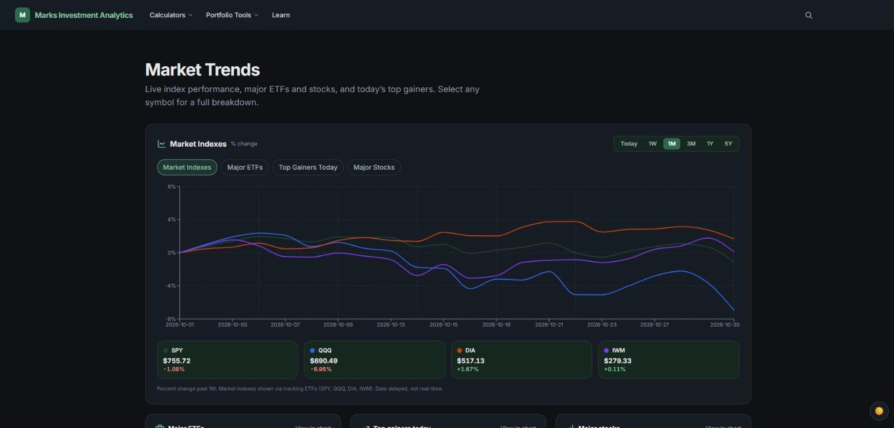
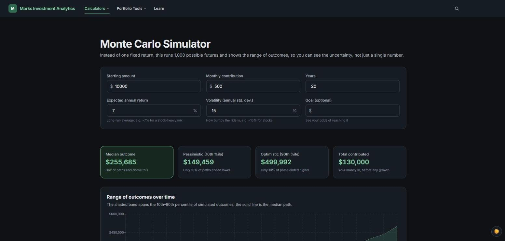
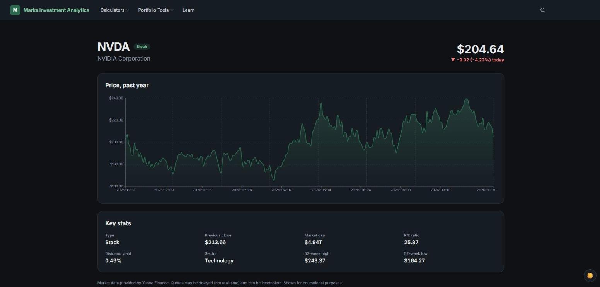

# Marks Investment Analytics

A full-stack personal finance platform: live market data, stock and fund research, portfolio building and backtesting, a Monte Carlo simulator, and a set of everyday financial calculators. Signed-in users can save their work.

**Live site:** https://marks-financial-services.vercel.app



| Monte Carlo simulator | Stock detail page |
| --- | --- |
|  |  |

> Educational tool only, not financial advice. Market data is delayed and can be incomplete.

---

## Contents

- [Features](#features)
- [Tech stack](#tech-stack)
- [How it works](#how-it-works)
  - [Architecture](#architecture)
  - [Market data layer](#market-data-layer)
  - [API routes](#api-routes)
  - [Calculation engine](#calculation-engine)
  - [Portfolios: grading, matching, backtesting](#portfolios-grading-matching-backtesting)
  - [Accounts and saved data](#accounts-and-saved-data)
- [Project structure](#project-structure)
- [Running it locally](#running-it-locally)
- [Design decisions](#design-decisions)
- [Limitations](#limitations)

---

## Features

**Markets & research**
- **Market Trends homepage:** index performance (SPY, QQQ, DIA, IWM), major ETFs, major stocks, and today's top gainers, with an interactive chart over Today / 1W / 1M / 3M / 1Y / 5Y.
- **Search:** look up any ticker or company name.
- **Security pages** (`/stock/[ticker]`): price history chart plus key stats for stocks, ETFs, and mutual funds (market cap, P/E, dividend yield, expense ratio, 52-week range, and more where available).
- **Compare** (`/compare`): look up several securities side by side.

**Portfolio tools**
- **Model portfolios:** a library of reference portfolios, from Conservative to Aggressive Growth.
- **Portfolio builder** (`/portfolios/build`): build your own mix of tickers and weights (cash allowed), then:
  - **Grade it** against your stated risk profile.
  - **Match it** against a model portfolio, by exact ticker and by similar fund.
  - **Backtest it** on real historical prices.
- **Portfolio compare** (`/portfolios/compare`): put portfolios next to each other.

**Calculators** (`/tools/*`)
| Tool | What it does |
| --- | --- |
| Mortgage | All-in monthly cost (principal, interest, tax, insurance, HOA), full amortization schedule, and the effect of extra payments |
| Budget | Sorts spending into needs, wants, and savings and compares it to the 50/30/20 rule |
| Debt payoff | Avalanche vs. snowball strategies, month by month, with total interest and payoff date for each |
| Retirement | Compound growth to retirement, in nominal and inflation-adjusted dollars |
| Savings goal | The monthly contribution needed to hit a target by a date, with a month-by-month projection |
| Savings allocator | Splits leftover monthly money across checking, debt, emergency fund, and investments, with a plain-English reason for each |
| Monte Carlo | Runs 1,000 simulated futures and shows the range of outcomes and the odds of hitting a goal |

**Accounts**
- Sign up / log in with Supabase Auth.
- **Saved scenarios:** save inputs in any tool and reopen, rename, or delete them from `/scenarios`.
- Saved user portfolios.

**Learn** (`/learn`): short guides such as *How compounding works*, *What an expense ratio is*, and *How backtests are built*.

---

## Tech stack

| Layer | Tools |
| --- | --- |
| Framework | Next.js 16 (App Router), React 19, TypeScript |
| Styling & UI | Tailwind CSS 4, Framer Motion, light/dark theme |
| Charts | Recharts |
| Market data | `yahoo-finance2` (server side only) |
| Auth & database | Supabase (Auth + Postgres with Row Level Security) |
| Hosting / CI | Vercel, with automatic deploys on every push to `main` |

---

## How it works

### Architecture

```
 Browser (React pages + Recharts)
   │                         │
   │ fetch /api/*            │ supabase-js (auth + saved data)
   ▼                         ▼
 Next.js API routes        Supabase
   │                        ├─ Auth (sessions)
   ▼                        └─ Postgres + Row Level Security
 lib/marketData/provider.ts     ├─ saved_scenarios
   │                            └─ user_portfolios
   ▼
 Yahoo Finance (yahoo-finance2)

 lib/finance, lib/portfolios, lib/funds: pure calculation modules
 used by the pages (no network, no UI)
```

There are three separate parts:

1. **Pages and components** (`app/`, `components/`) handle UI only.
2. **Pure logic** (`lib/finance`, `lib/portfolios`, `lib/funds`) is plain TypeScript functions: inputs in, results out. They don't fetch data or render anything, which keeps the math easy to read and test.
3. **Data access** is limited to two places: the market-data provider (server side) and the Supabase helpers (client side).

### Market data layer

`lib/marketData/provider.ts` is the **only file that knows Yahoo Finance exists**. It exposes a small set of functions (`getQuote`, `getPriceHistory`, search, and security detail) and translates Yahoo's responses into the app's own types in `lib/marketData/types.ts` (`Quote`, `PricePoint`, `PriceHistory`, `SecurityDetail`, and so on).

- Every page, chart, and API route works with those app types, never with Yahoo's.
- **Switching providers** (for example to Financial Modeling Prep) means rewriting the insides of `provider.ts` and nothing else.
- Fields a provider doesn't return come back as `null`, and the UI shows "Not available" rather than a guessed number.
- Errors are thrown as plain, readable messages (for example `No quote found for "XYZ", is the ticker valid?`) that the API passes straight to the UI.
- Supported history ranges: 1mo, 3mo, 6mo, 1y, 3y, 5y.

### API routes

The browser never calls Yahoo directly. It calls these Next.js route handlers, which call the provider on the server:

| Route | Method | Purpose |
| --- | --- | --- |
| `/api/quote?symbol=` | GET | Current quote for one ticker |
| `/api/history?symbol=&range=` | GET | Closing-price history |
| `/api/security?symbol=` | GET | Full detail for a stock, ETF, or fund |
| `/api/search?q=` | GET | Ticker / company search |
| `/api/market` | GET | Homepage market snapshot (cached 60s) |
| `/api/market/series?group=` | GET | Chart series for indexes, ETFs, gainers, or stocks (cached 60s) |
| `/api/backtest` | POST | Fetches history for every holding and runs the backtest |

The homepage routes use `revalidate = 60`, so heavy traffic doesn't make a Yahoo request on every page view.

### Calculation engine

Each calculator is a pure module in `lib/finance/`. A few highlights:

**Monte Carlo** (`monteCarlo.ts`) runs 1,000 simulated paths by default (adjustable from 100 to 5,000):

```
each month, for each path:
  monthlyReturn ~ Normal(monthlyMean, monthlyStdDev)
  balance = max(0, balance × (1 + monthlyReturn) + contribution)

monthlyMean   = (1 + annualReturn)^(1/12) − 1   // geometric, so it compounds back to the annual input
monthlyStdDev = annualVolatility / √12
```

It reports the 10th / 25th / 50th / 75th / 90th percentile balance for each year, plus the best case, worst case, and the probability of reaching an optional goal. The random generator is **seeded**, so the same inputs always produce the same chart. That avoids results jumping around on re-render and prevents server/client hydration mismatches.

**Mortgage** (`mortgage.ts`) has three functions: an all-in monthly cost breakdown, a month-by-month and year-by-year amortization schedule, and a comparison of payoff time and interest with and without extra payments.

**Debt payoff** (`debtPayoff.ts`) simulates both strategies month by month:
- **Avalanche:** extra money goes to the highest interest rate first, which costs the least total interest.
- **Snowball:** extra money goes to the smallest balance first, which gives quicker wins.

Minimum payments freed up by paid-off debts roll into the extra pool, and any leftover cascades to the next debt in the same month. If payments can't outrun interest, the simulation stops and names which debts' minimums are too low, instead of looping forever. There's also a hard cap of 100 years.

**Retirement** (`retirement.ts`) compounds monthly contributions and also reports every value in **today's dollars** by discounting for inflation.

**Savings allocator** (`allocator.ts`) follows a common priority ladder: a one-month checking buffer, then high-interest debt, then a 3–6 month emergency fund, then investing. Each recommendation comes with a written reason.

### Portfolios: grading, matching, backtesting

**Grading** (`lib/portfolios/gradePortfolio.ts`) classifies each holding as stock, bond, or cash using an explicit asset-class map of common ETFs, funds, and large stocks. It works out the portfolio's stock percentage and reports the closest risk profile and how far that is from the one the user stated. Tickers that aren't in the map are left out and listed, never guessed.

**Similar-fund matching** (`lib/funds/similarity.ts`, `matchHoldings.ts`) compares a user portfolio to a model portfolio in two passes that are never mixed:
1. **Exact match:** the same ticker appears in both.
2. **Similar match:** for a holding with no exact match, the best fund scoring at least **70 / 100** on a weighted similarity score. The score is built from asset class (40), region (25), market cap (15), and other stated attributes. Different asset classes always score 0, and if either fund has no profile the result is "not enough data" rather than a guess.

**Backtesting** (`lib/portfolios/backtest.ts`):
- Collapses each holding's daily closes into monthly closes.
- Rebalances to the target weights every month, so the portfolio's return is the weighted average of each holding's monthly return.
- Treats cash as 0% per month.
- Reports total return, annualized (geometric) return, and the value over time.
- **Handles missing data loudly:** a holding with no data stops the backtest with an error, and if one holding's history starts later than the others, the window is shortened and a warning names that holding.
- Assumes no fees, taxes, or trading costs. The page states all of these assumptions.

### Accounts and saved data

- **Auth:** `lib/auth/AuthContext.tsx` wraps the app in a React context backed by Supabase Auth. It loads the current session on start and listens for login, logout, and token refresh, so the whole UI updates without a page reload. The app never sees or stores passwords.
- **Saved scenarios:** one table, `saved_scenarios`, stores saved inputs for every tool. Each row has a `tool` key and a `data` JSONB column with that tool's inputs. Because the database can't check what's inside the JSON, `lib/scenarios/savedScenarios.ts` has a validator for each tool. The validator fills in defaults, so an old saved scenario never crashes a tool whose inputs changed later.
- **User portfolios:** `user_portfolios` stores `{symbol, weight}` holdings as JSONB.
- **Security:** both tables use **Row Level Security**. `user_id` defaults to `auth.uid()` and is never sent from the browser, so users can only read and write their own rows. Data helpers return errors as plain strings for the UI, and saved contents are never logged.

---

## Project structure

```
app/
  page.tsx                  Market Trends homepage
  api/                      Server routes (quote, history, security, search, market, backtest)
  stock/[ticker]/           Security detail page
  compare/                  Side-by-side security lookup
  portfolios/               Model portfolios, builder, compare
  tools/                    mortgage, budget, debt-payoff, retirement, savings-goal, allocator, monte-carlo
  scenarios/                Saved scenarios manager
  learn/                    Guides
  login/, signup/           Auth pages
components/
  home/                     Homepage sections (market data, search, feature grid)
  ui/                       Shared UI (Button, Card, Badge, Section, Reveal, ...)
  NavBar, Footer, ThemeToggle, ScenarioManager, SecurityDetail
lib/
  marketData/               provider.ts (the only Yahoo-aware file) + app-owned types
  finance/                  Pure calculator math
  portfolios/               Model portfolios, grading, backtest, user portfolio data helpers
  funds/                    Fund profiles, similarity scoring, holding matching
  scenarios/                Saved-scenario data helpers + per-tool validation
  auth/                     AuthContext (Supabase session state)
  supabase/                 Browser Supabase client
supabase/migrations/        SQL for the saved_scenarios table and its RLS policies
docs/screenshots/           Images used in this README
```

---

## Running it locally

**Requirements:** Node.js 20+ and a free [Supabase](https://supabase.com) project.

```bash
git clone https://github.com/JasonMarks22/Marks-Financial-Services.git
cd Marks-Financial-Services
npm install
```

Create a file named `.env.local` in the project root. It's gitignored, so it's never committed.

```bash
NEXT_PUBLIC_SUPABASE_URL=your-project-url
NEXT_PUBLIC_SUPABASE_ANON_KEY=your-anon-key
```

Both values are under Project Settings → API in the Supabase dashboard. The anon key is designed to be public, and Row Level Security protects the data. Never put the `service_role` key in a `NEXT_PUBLIC_` variable.

Set up the database by running `supabase/migrations/0001_saved_scenarios.sql` in the Supabase SQL editor. The `user_portfolios` table is not in a migration yet (see [Limitations](#limitations)).

Then start it:

```bash
npm run dev      # http://localhost:3000
npm run build    # production build
npm run lint     # ESLint
```

Market data needs no API key, since `yahoo-finance2` works without one.

---

## Design decisions

- **One provider file.** Isolating Yahoo behind `provider.ts` and app-owned types means the data source can be swapped without touching any page or chart.
- **Math in pure functions.** Calculators, grading, similarity, and backtesting have no UI or network code, so they're easy to read, test, and reuse.
- **Honest numbers over guessed numbers.** Missing data shows "Not available", unknown tickers are excluded from grades, similar funds are never labeled as identical, and backtests warn when the date range is cut short.
- **Reproducible simulations.** A seeded random generator makes Monte Carlo results stable for the same inputs.
- **Security by default.** Row Level Security plus `user_id = auth.uid()` defaults mean the client can't read or write anyone else's data.
- **One table for every tool's saves**, with validation in code, so adding a new tool doesn't need a new table.

---

## Limitations

- **Simplified models:** the Monte Carlo simulator assumes normally distributed, independent monthly returns. Backtests ignore fees, taxes, and trading costs, and assume monthly rebalancing.
- **Data quality:** Yahoo Finance data is delayed, unofficial, and sometimes incomplete.
- **Classification coverage:** grading and similar-fund matching only cover tickers in the built-in maps. Anything else is excluded.
- **Schema:** the `user_portfolios` table is not yet defined in a migration file.
- **No automated tests yet.** The pure `lib/` modules are set up to make adding unit tests straightforward.

---

## About

Built by **Jason Marks**, an Information Systems student at BYU. I built this with AI coding tools; I made the product, stack, and architecture decisions and reviewed and tested every change.

- Portfolio: https://jasonmarks22.github.io
- LinkedIn: https://www.linkedin.com/in/jasonmarks10
